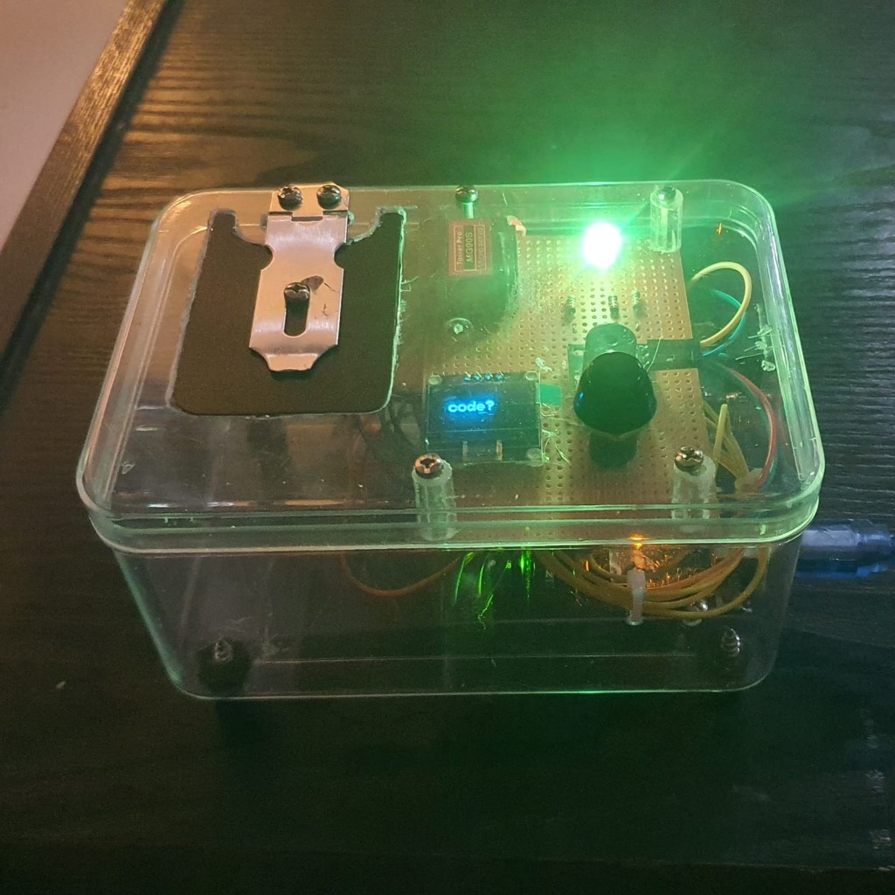
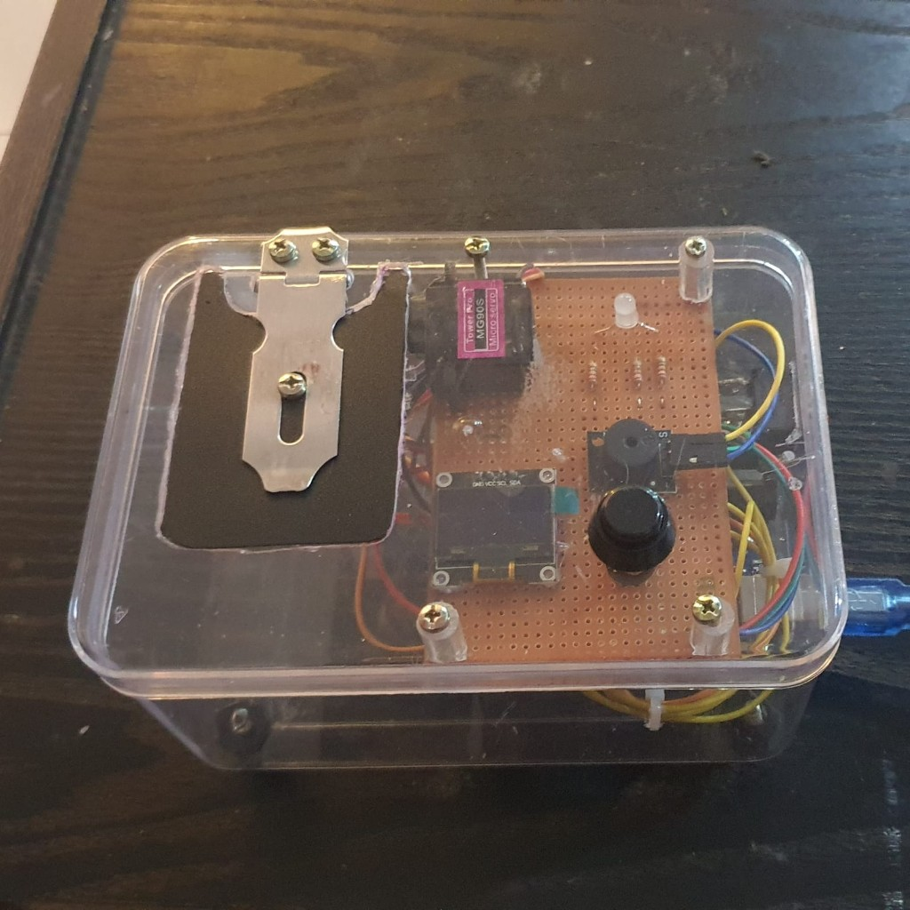
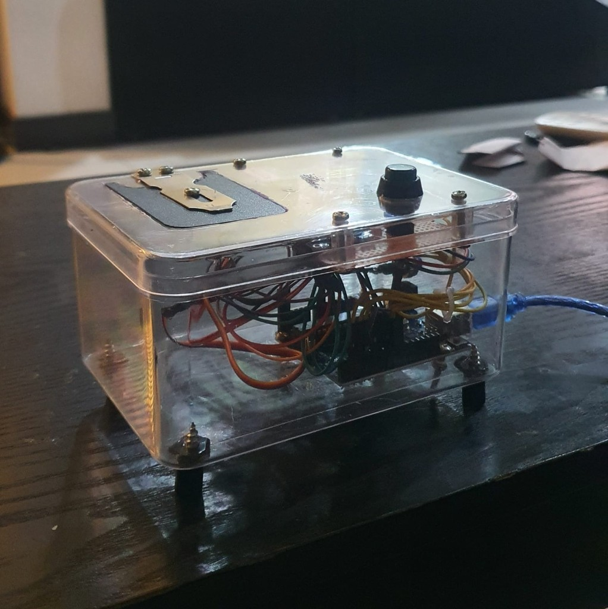
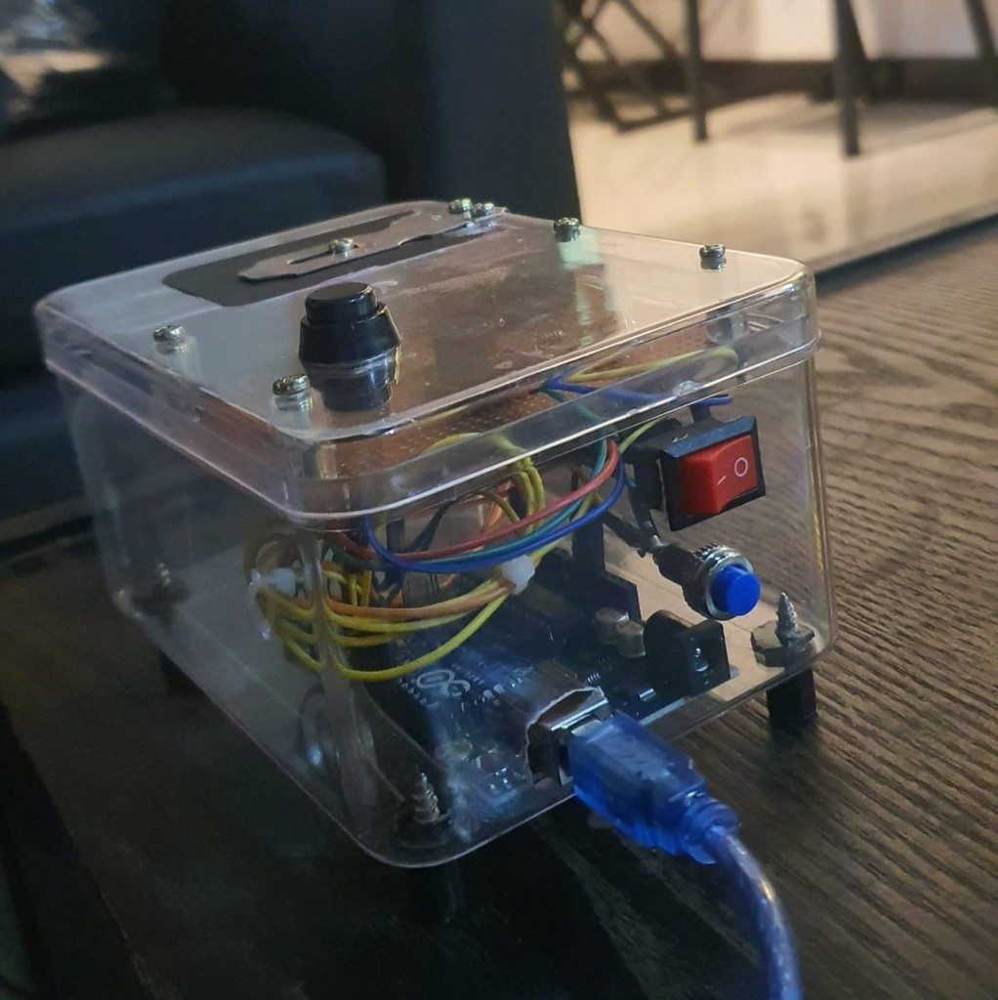

# mosre-code-locker

Arduino Morse-code locker with OLED display, RGB LED, buzzer, and servo latch.

**Exhibition name:** SnA Locker (Simple and Advanced)

## Author

- **Name:** Rehan Fernando
- **Email:** rehanfernandolk@gmail.com
- **Branch:** Negombo

## What it does

Enter a Morse-code password with a button. On a correct match the servo unlocks; wrong codes stay locked. An OLED shows prompts and live input, an RGB LED shows status, and a buzzer gives audio feedback. A reset switch allows changing the password.

Default password is Morse for **AA**: `.- .-`

## Prototype

Finished build in a clear enclosure — OLED prompt, Morse button, servo latch, and Arduino Uno inside.

<p align="center">
  <br />
  <em>Running unit — OLED shows <code>code?</code></em>
</p>

<p align="center">
  
  &nbsp;
  
  &nbsp;
  <br />
  <em>Board · Enclosure · Side controls</em>
</p>

## Hardware

| Component | Spec / notes | Uno pin |
|---|---|---|
| Arduino Uno R3 | ATmega328P | — |
| OLED SSD1306 | 0.96" 128×64 I2C (`0x3C`) | SDA→A4, SCL→A5, VCC→5V, GND→GND |
| RGB LED | Common cathode + 220 Ω | R→D6, G→D7, B→D8, common→GND |
| Buzzer | HW-508 module | S→D9, +→5V, −→GND |
| Morse button | Momentary | D3 ↔ GND |
| Clear button | Momentary | D4 ↔ GND |
| Reset switch | ON/OFF | D2 ↔ GND |
| Servo | SG90 / MG90S | Signal→D10, V+→5V, GND→GND |

### RGB status

| State | Color |
|---|---|
| Idle / lock | Yellow |
| Password reset mode | Blue |
| Correct password | Green |
| Wrong password | Red |

## Build & upload

```bash
arduino-cli compile --fqbn arduino:avr:uno --libraries libraries --output-dir build sketch
arduino-cli upload -p COMx --fqbn arduino:avr:uno --input-dir build
```

Replace `COMx` with your port from `arduino-cli board list`.

Wokwi simulator uses `diagram.json` and firmware in `build/`.

## How to use

1. Reset switch **OFF** → lock mode
2. Morse button: short = `.` , long = `-`
3. Pause ~2 s to submit
4. Clear button clears current input
5. Reset switch **ON** → enter old password, then new password; switch **OFF** to save

## Project layout

- `sketch/` — Arduino sketch (CLI / Wokwi build)
- `src/` — PlatformIO entry
- `libraries/` — local Arduino libraries
- `docs/` — wiring map, parts list, exhibition poster, prototype photos (`docs/images/`)

## License

MIT
